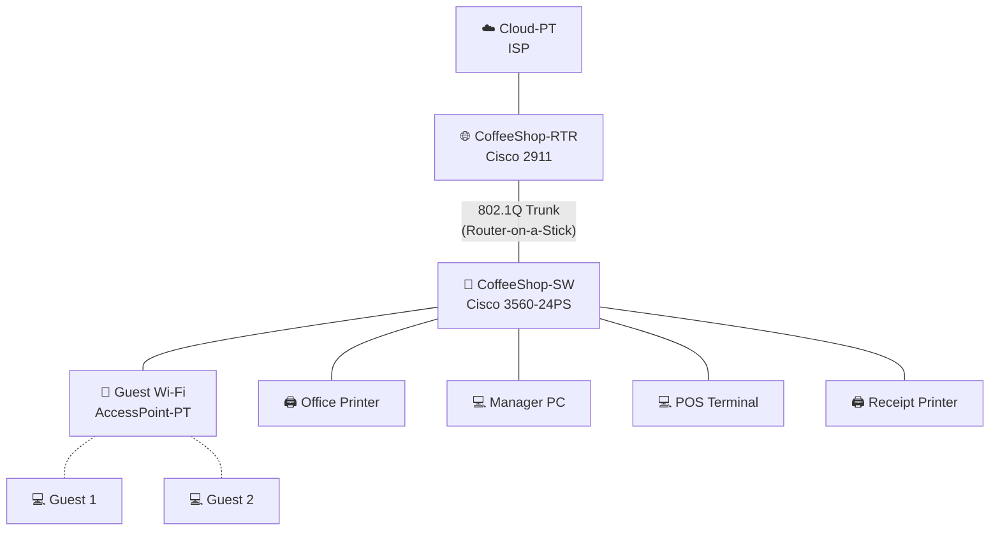
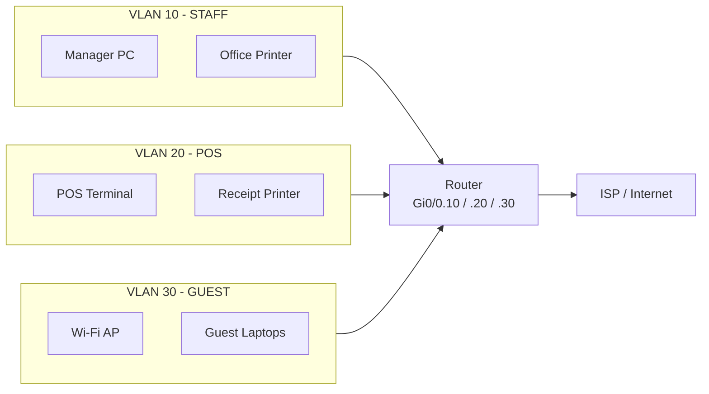
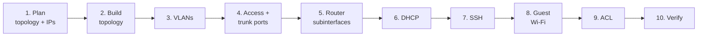
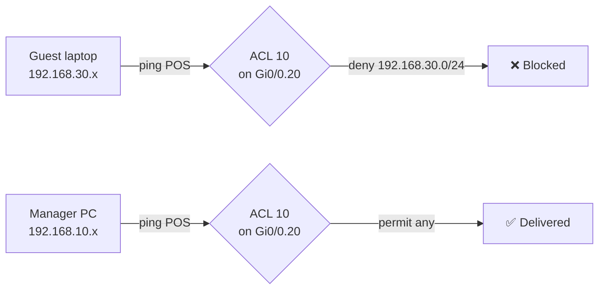

# ☕ Atika's Coffee Shop Network

A segmented small-business network for a coffee shop, designed, configured, and tested in **Cisco Packet Tracer**.
Staff and POS systems are isolated from customer guest Wi-Fi, devices are managed securely over SSH, and every layer is verified end to end.

📺 **Video walkthrough:** [Watch the tutorial on YouTube](https://www.youtube.com/watch?v=pKnmaU1zhUI)


---

## 📑 Table of Contents

1. [Project Overview](#1-project-overview)
2. [Skills Demonstrated](#2-skills-demonstrated)
3. [Tools and Technologies Used](#3-tools-and-technologies-used)
4. [Network Topology](#4-network-topology)
5. [VLAN and IP Addressing Plan](#5-vlan-and-ip-addressing-plan)
6. [Switch Port Map](#6-switch-port-map)
7. [Step-by-Step Implementation](#7-step-by-step-implementation)
8. [Verification and Testing](#8-verification-and-testing)
9. [Challenges and Lessons Learned](#9-challenges-and-lessons-learned)
10. [Future Improvements](#10-future-improvements)
11. [Repository Structure](#11-repository-structure)
12. [How to Run the Lab](#12-how-to-run-the-lab)
13. [Author](#13-author)

---

## 1. Project Overview

A coffee shop needs reliable point-of-sale (POS) and printing, plus free Wi-Fi for customers, without letting customers touch business systems.

| Goal | How it is achieved |
|---|---|
| Keep POS and staff devices secure | Separate VLANs and a standard ACL |
| Give customers free internet | Dedicated Guest VLAN with a Wi-Fi access point |
| Reduce manual setup | DHCP pools for every VLAN |
| Manage devices safely | SSH instead of Telnet |
| Fast, reliable endpoint connectivity | Access ports with PortFast |
| One router for all VLANs | Router-on-a-Stick inter-VLAN routing |

---

## 2. Skills Demonstrated

- Network planning and topology design
- VLAN configuration
- Router-on-a-Stick inter-VLAN routing
- Trunk and access port configuration
- DHCP configuration
- SSH remote management
- PortFast configuration
- Guest Wi-Fi configuration
- Standard Access Control Lists (ACLs)
- End-to-end network verification

---

## 3. Tools and Technologies Used

**Simulation and devices (virtual)**
- Cisco Packet Tracer 8.x
- Cisco 2911 router
- Cisco 3560-24PS Layer 3 switch
- Access Point-PT (guest Wi-Fi)
- PC-PT, Laptop-PT, and Printer-PT end devices
- Cloud-PT (simulated ISP)

**Networking technologies and protocols**
- VLANs (IEEE 802.1Q)
- Router-on-a-Stick inter-VLAN routing
- Trunk and access ports
- DHCP
- SSH (secure remote management)
- PortFast (Spanning Tree Protocol)
- WPA2 wireless security
- Standard ACLs

**Configuration and verification**
- Cisco IOS Command Line Interface (CLI)
- `show` commands (`show vlan brief`, `show ip interface brief`, `show interfaces trunk`, `show access-lists`)
- `ping` and `ipconfig` for end-to-end testing

**Documentation and version control**
- Git and GitHub
- Markdown
- Mermaid (diagrams)
- YouTube (video walkthrough)

---

## 4. Network Topology


### Physical view



### Logical view



---

## 5. VLAN and IP Addressing Plan

| VLAN | Name | Subnet | Gateway | DHCP Range | Devices |
|---|---|---|---|---|---|
| 10 | STAFF | 192.168.10.0/24 | 192.168.10.1 | .10 - .254 | Manager PC, Office Printer |
| 20 | POS | 192.168.20.0/24 | 192.168.20.1 | .10 - .254 | POS Terminal, Receipt Printer |
| 30 | GUEST | 192.168.30.0/24 | 192.168.30.1 | .10 - .254 | Guest AP, Guest laptops |

Management addresses (optional):

| Device | Interface | IP Address |
|---|---|---|
| CoffeeShop-RTR | Gi0/0.10 | 192.168.10.1 |
| CoffeeShop-SW | VLAN 10 SVI | 192.168.10.2 |

---

## 6. Switch Port Map

| Port | Mode | VLAN | Connected to |
|---|---|---|---|
| Gi0/1 | Trunk | 10, 20, 30 | CoffeeShop-RTR |
| Fa0/1 | Access + PortFast | 10 | Manager PC |
| Fa0/2 | Access + PortFast | 10 | Office Printer |
| Fa0/3 | Access + PortFast | 20 | POS Terminal |
| Fa0/4 | Access + PortFast | 20 | Receipt Printer |
| Fa0/5 | Access + PortFast | 30 | Guest Wi-Fi AP |

---

## 7. Step-by-Step Implementation



### Step 1: Plan the network
Decide on the devices, VLAN IDs, subnets, gateways, and which ports connect to what (see sections 5 and 6).

### Step 2: Build the topology in Packet Tracer
1. Place the Cloud-PT, 2911 router, 3560-24PS switch, access point, PCs, printers, and laptops.
2. Connect them with copper straight-through cables.
3. Rename devices: `CoffeeShop-RTR`, `CoffeeShop-SW`, `Manager PC`, `POS Terminal`, and so on.
4. Connect Gi0/0 on the router to Gi0/1 on the switch.

### Step 3: Create VLANs on the switch

```
Switch> enable
Switch# configure terminal
Switch(config)# hostname CoffeeShop-SW
CoffeeShop-SW(config)# vlan 10
CoffeeShop-SW(config-vlan)# name STAFF
CoffeeShop-SW(config-vlan)# vlan 20
CoffeeShop-SW(config-vlan)# name POS
CoffeeShop-SW(config-vlan)# vlan 30
CoffeeShop-SW(config-vlan)# name GUEST
CoffeeShop-SW(config-vlan)# exit
```

### Step 4: Configure access ports (with PortFast) and the trunk

```
! STAFF ports
CoffeeShop-SW(config)# interface range fa0/1 - 2
CoffeeShop-SW(config-if-range)# switchport mode access
CoffeeShop-SW(config-if-range)# switchport access vlan 10
CoffeeShop-SW(config-if-range)# spanning-tree portfast
CoffeeShop-SW(config-if-range)# exit

! POS ports
CoffeeShop-SW(config)# interface range fa0/3 - 4
CoffeeShop-SW(config-if-range)# switchport mode access
CoffeeShop-SW(config-if-range)# switchport access vlan 20
CoffeeShop-SW(config-if-range)# spanning-tree portfast
CoffeeShop-SW(config-if-range)# exit

! GUEST (access point) port
CoffeeShop-SW(config)# interface fa0/5
CoffeeShop-SW(config-if)# switchport mode access
CoffeeShop-SW(config-if)# switchport access vlan 30
CoffeeShop-SW(config-if)# spanning-tree portfast
CoffeeShop-SW(config-if)# exit

! Trunk to router
CoffeeShop-SW(config)# interface gi0/1
CoffeeShop-SW(config-if)# switchport trunk encapsulation dot1q
CoffeeShop-SW(config-if)# switchport mode trunk
CoffeeShop-SW(config-if)# switchport trunk allowed vlan 10,20,30
CoffeeShop-SW(config-if)# exit
```

### Step 5: Configure Router-on-a-Stick subinterfaces

```
Router> enable
Router# configure terminal
Router(config)# hostname CoffeeShop-RTR

CoffeeShop-RTR(config)# interface gi0/0
CoffeeShop-RTR(config-if)# no shutdown
CoffeeShop-RTR(config-if)# exit

CoffeeShop-RTR(config)# interface gi0/0.10
CoffeeShop-RTR(config-subif)# description STAFF
CoffeeShop-RTR(config-subif)# encapsulation dot1Q 10
CoffeeShop-RTR(config-subif)# ip address 192.168.10.1 255.255.255.0
CoffeeShop-RTR(config-subif)# exit

CoffeeShop-RTR(config)# interface gi0/0.20
CoffeeShop-RTR(config-subif)# description POS
CoffeeShop-RTR(config-subif)# encapsulation dot1Q 20
CoffeeShop-RTR(config-subif)# ip address 192.168.20.1 255.255.255.0
CoffeeShop-RTR(config-subif)# exit

CoffeeShop-RTR(config)# interface gi0/0.30
CoffeeShop-RTR(config-subif)# description GUEST
CoffeeShop-RTR(config-subif)# encapsulation dot1Q 30
CoffeeShop-RTR(config-subif)# ip address 192.168.30.1 255.255.255.0
CoffeeShop-RTR(config-subif)# exit
```

### Step 6: Configure DHCP

```
CoffeeShop-RTR(config)# ip dhcp excluded-address 192.168.10.1 192.168.10.9
CoffeeShop-RTR(config)# ip dhcp excluded-address 192.168.20.1 192.168.20.9
CoffeeShop-RTR(config)# ip dhcp excluded-address 192.168.30.1 192.168.30.9

CoffeeShop-RTR(config)# ip dhcp pool STAFF
CoffeeShop-RTR(dhcp-config)# network 192.168.10.0 255.255.255.0
CoffeeShop-RTR(dhcp-config)# default-router 192.168.10.1
CoffeeShop-RTR(dhcp-config)# dns-server 8.8.8.8
CoffeeShop-RTR(dhcp-config)# exit

CoffeeShop-RTR(config)# ip dhcp pool POS
CoffeeShop-RTR(dhcp-config)# network 192.168.20.0 255.255.255.0
CoffeeShop-RTR(dhcp-config)# default-router 192.168.20.1
CoffeeShop-RTR(dhcp-config)# dns-server 8.8.8.8
CoffeeShop-RTR(dhcp-config)# exit

CoffeeShop-RTR(config)# ip dhcp pool GUEST
CoffeeShop-RTR(dhcp-config)# network 192.168.30.0 255.255.255.0
CoffeeShop-RTR(dhcp-config)# default-router 192.168.30.1
CoffeeShop-RTR(dhcp-config)# dns-server 8.8.8.8
CoffeeShop-RTR(dhcp-config)# exit
```

Set each PC, printer, and laptop to **DHCP** in its IP Configuration tab.

### Step 7: Configure SSH remote management

**On the router:**

```
CoffeeShop-RTR(config)# ip domain-name coffeeshop.local
CoffeeShop-RTR(config)# username admin secret <your-password>
CoffeeShop-RTR(config)# crypto key generate rsa modulus 2048
CoffeeShop-RTR(config)# ip ssh version 2
CoffeeShop-RTR(config)# line vty 0 4
CoffeeShop-RTR(config-line)# transport input ssh
CoffeeShop-RTR(config-line)# login local
CoffeeShop-RTR(config-line)# exit
CoffeeShop-RTR(config)# enable secret <your-enable-password>
```

**On the switch (management IP in VLAN 10):**

```
CoffeeShop-SW(config)# interface vlan 10
CoffeeShop-SW(config-if)# ip address 192.168.10.2 255.255.255.0
CoffeeShop-SW(config-if)# no shutdown
CoffeeShop-SW(config-if)# exit
CoffeeShop-SW(config)# ip default-gateway 192.168.10.1
CoffeeShop-SW(config)# ip domain-name coffeeshop.local
CoffeeShop-SW(config)# username admin secret <your-password>
CoffeeShop-SW(config)# crypto key generate rsa modulus 2048
CoffeeShop-SW(config)# ip ssh version 2
CoffeeShop-SW(config)# line vty 0 4
CoffeeShop-SW(config-line)# transport input ssh
CoffeeShop-SW(config-line)# login local
CoffeeShop-SW(config-line)# exit
```

**Test from the Manager PC:** open Command Prompt and run:

```
ssh -l admin 192.168.10.1
```

### Step 8: Configure Guest Wi-Fi

1. Click the **Access Point** → **Config** → **Port 1 (Wireless)**.
2. Set:
   - **SSID:** `Guest-WiFi`
   - **Authentication:** WPA2-PSK
   - **Passphrase:** `<your-passphrase>`
3. On **Guest 1** and **Guest 2**: swap the wired NIC for the wireless module (if needed), open **Config → Wireless0**, enter the same SSID and passphrase, and set IP configuration to **DHCP**.
4. Confirm both laptops receive a `192.168.30.x` address.

### Step 9: Configure the Standard ACL (isolate Guest traffic)

Standard ACLs filter by **source address only**, so they are placed **as close to the destination as possible**.

```
CoffeeShop-RTR(config)# access-list 10 deny 192.168.30.0 0.0.0.255
CoffeeShop-RTR(config)# access-list 10 permit any

! Protect the POS VLAN
CoffeeShop-RTR(config)# interface gi0/0.20
CoffeeShop-RTR(config-subif)# ip access-group 10 out
CoffeeShop-RTR(config-subif)# exit

! Optional: also protect the STAFF VLAN
CoffeeShop-RTR(config)# interface gi0/0.10
CoffeeShop-RTR(config-subif)# ip access-group 10 out
CoffeeShop-RTR(config-subif)# exit
```

**Result:** guest devices cannot reach POS (or staff) devices, while staff, POS, and internet-bound traffic still works.

### Step 10: Save the configuration

```
CoffeeShop-RTR# copy running-config startup-config
CoffeeShop-SW# copy running-config startup-config
```

---

## 8. Verification and Testing

| # | Test | Command / Action | Expected result | Screenshot |
|---|---|---|---|---|
| 1 | VLANs exist | `show vlan brief` | VLANs 10, 20, 30 with the correct ports | `screenshots/show-vlan-brief.png` |
| 2 | Trunk is up | `show interfaces trunk` | Gi0/1 trunking, VLANs 10,20,30 allowed | `screenshots/show-trunk.png` |
| 3 | Router interfaces | `show ip interface brief` | Subinterfaces up/up | `screenshots/show-ip-int-brief.png` |
| 4 | DHCP works | `ipconfig` on each device | Address from the correct pool | `screenshots/dhcp-leases.png` |
| 5 | Inter-VLAN routing | Manager PC pings POS Terminal | ✅ Success | `screenshots/ping-staff-pos.png` |
| 6 | Guest isolation | Guest laptop pings POS Terminal | ❌ Blocked by ACL | `screenshots/ping-guest-pos-blocked.png` |
| 7 | Guest internet access | Guest laptop pings ISP/Cloud | ✅ Success | `screenshots/ping-guest-isp.png` |
| 8 | ACL hit counters | `show access-lists` | Deny counter increments | `screenshots/show-access-lists.png` |
| 9 | SSH access | `ssh -l admin 192.168.10.1` | Login succeeds | `screenshots/ssh-login.png` |

### ACL decision flow



### Troubleshooting commands

```
show running-config
show vlan brief
show interfaces trunk
show ip interface brief
show ip dhcp binding
show access-lists
show ip ssh
```

---

## 9. Challenges and Lessons Learned

> ✏️ **Write your real experience here.** Examples to prompt you:
> - What broke first, and how did you find the cause?
> - Did the trunk, encapsulation VLAN ID, or a missing `no shutdown` cause problems?
> - What did you learn about ACL placement (why a standard ACL goes near the destination)?
> - What surprised you about DHCP or Guest Wi-Fi?

---

## 10. Future Improvements

- Replace the standard ACL with an **extended ACL** for finer control
- Add **port security** on staff-facing ports
- Add **NAT/PAT** toward the ISP
- Add a dedicated **management VLAN** (for example, VLAN 99)
- Add a **syslog server** and review logs for threat hunting practice
- Add **IPv6** addressing

---

## 11. Repository Structure

```
atikas-coffee-shop-network/
├── README.md
├── topology/
│   └── coffee-shop-topology.png
├── configs/
│   ├── CoffeeShop-RTR.txt
│   └── CoffeeShop-SW.txt
├── screenshots/
│   ├── show-vlan-brief.png
│   ├── show-trunk.png
│   ├── show-ip-int-brief.png
│   ├── dhcp-leases.png
│   ├── ping-staff-pos.png
│   ├── ping-guest-pos-blocked.png
│   ├── ping-guest-isp.png
│   ├── show-access-lists.png
│   └── ssh-login.png
└── lab/
    └── coffee-shop-network.pkt
```

---

## 12. How to Run the Lab

1. Install **Cisco Packet Tracer 8.x**.
2. Download or clone this repository.
3. Open `lab/coffee-shop-network.pkt`.
4. Wait for all link lights to turn green.
5. Follow the tests in [section 8](#8-verification-and-testing).

Full configs are in the [`configs/`](configs/) folder.

---

## 13. Author

**Atika**

- 💼 LinkedIn: `<your-linkedin-url>`
- 🐦 X: `<your-x-url>`
- 📺 Tutorial: https://www.youtube.com/watch?v=pKnmaU1zhUI

⭐ If this project helped you, consider starring the repo. Feedback and suggestions are welcome!
